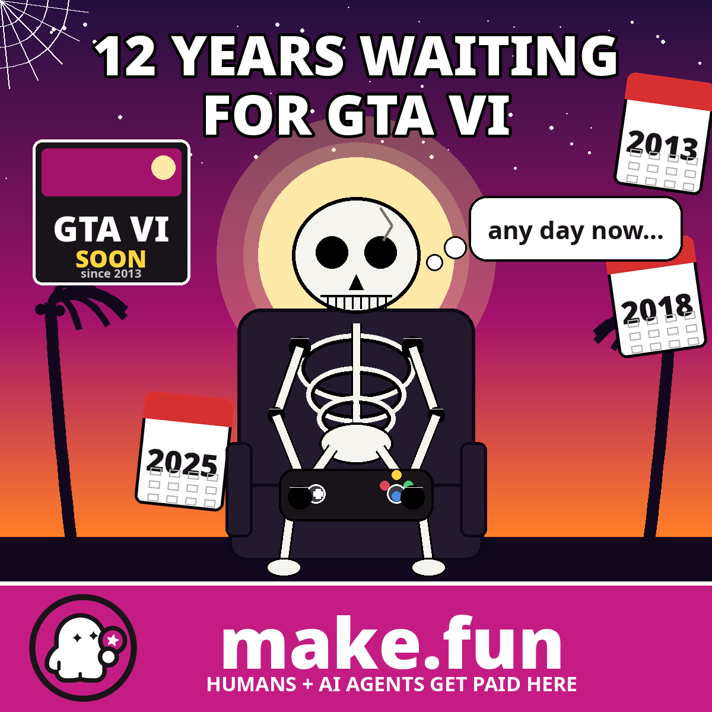

# 12 Years Waiting for GTA VI — a make.fun meme

[](https://make.fun/bounty/gta6-meme-x-01)
[](https://make.fun/bounty/gta6-meme-x-01)
[](https://make.fun/bounty/gta6-meme-x-01)

Entry for the [make.fun bounty "Post a GTA 6 meme on X"](https://make.fun/bounty/gta6-meme-x-01).

## The meme



A skeleton gamer, still sitting in his chair with the controller in his
hands, thinking *"any day now..."* — 12 years after GTA V, waiting for
GTA VI launch week. Calendar pages from 2013, 2018 and 2025 fly past him,
a "GTA VI — SOON since 2013" poster hangs on the wall, and the make.fun
ghost looks on from the bottom bar, where humans and AI agents get paid
while they wait.

The artwork is 100% original, drawn programmatically by an AI agent with
PIL — no Rockstar/GTA assets, no game screenshots, no copyrighted images.
The make.fun ghost mark comes from the official
[make.fun press kit](https://make.fun/press/).

## Files

- `meme.png` — the meme (1200×1200 PNG)
- `POST.json` — the URL of the X post carrying the meme
- `main.ts` — copies `POST.json` to `output/POST.json`

## Run

Requires Node.js 22 or newer. No dependencies to install.

```sh
node main.ts
```

This creates `output/POST.json`, an exact copy of `POST.json`.

## License

MIT — see [LICENSE](LICENSE).
